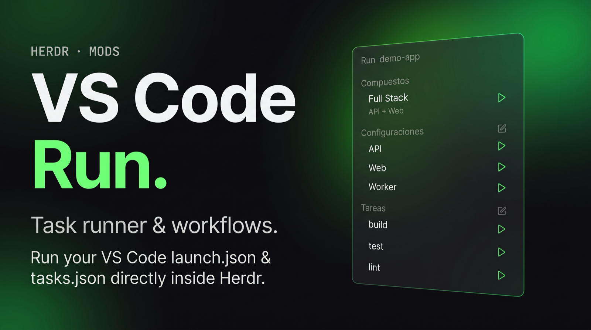

# herdr-mods

Mods para [Herdr](https://herdr.dev), la app de escritorio para terminales y agentes.

## Mods

### [VS Code Run](launch/) (`launch`)

Muestra en el sidebar las configuraciones de `.vscode/launch.json` y las tareas de `.vscode/tasks.json` de la carpeta en la que estás, cada una con su botón ▶. Cada una se abre en su propia pestaña de Herdr, y mientras está abierta puedes reiniciarla (↻) o detenerla (■). Un compuesto abre una sola pestaña dividida, con una terminal por cada configuración.



- **Configuraciones:** `node`, `node-terminal`, `python`, `coreclr`/`dotnet`.
- **Tareas:** `shell`, `process` y `npm`, con `dependsOn`, `preLaunchTask`, `cwd`, `env` y variables como `${workspaceFolder}`.
- `serverReadyAction` abre en el navegador la URL que imprima el servidor.
- No incluye depurador: cada configuración se ejecuta como un comando normal.

> ⚠️ Ejecuta los comandos de tus proyectos tal como están escritos (`sh -c`), lee los archivos `.vscode/` de la carpeta actual y de las de arriba, y usa `code`, `open` y `hc read`. No se conecta a internet. Úsalo solo en repos de confianza.

#### Instalar

```sh
git clone https://github.com/zayser99/herdr-mods.git
cp -R herdr-mods/launch ~/.config/herdr-app/mods/launch
herdr-app check ~/.config/herdr-app/mods/launch
```

Después agrégalo como bloque en tu layout. Por ejemplo, debajo de Agents en un clon de `main` (`herdr-app do layout.clone '{"name":"main","as":"mi-layout"}'`), dentro de la columna `sidebar-lists`:

```json
{ "id": "launch", "type": "block", "size": { "weight": 1 }, "min": 90, "content": { "mod": "launch" } }
```

O pídeselo a tu agente: *"agrega el mod https://github.com/zayser99/herdr-mods/tree/main/launch a mi sidebar"*.

#### Atajos (opcional)

El mod acepta los comandos `launch.c1`, `launch.k2` y `launch.t3`, que inician el compuesto, la configuración o la tarea con ese número. También acepta `launch.stop-t3` y `launch.restart-c1`. En `keys.json`:

```json
{ "global": { "alt-shift-1": "launch.k1", "alt-shift-b": "launch.t1" } }
```

`RECIPE.md` describe el mod con detalle, para que otro agente pueda reconstruirlo desde cero.
