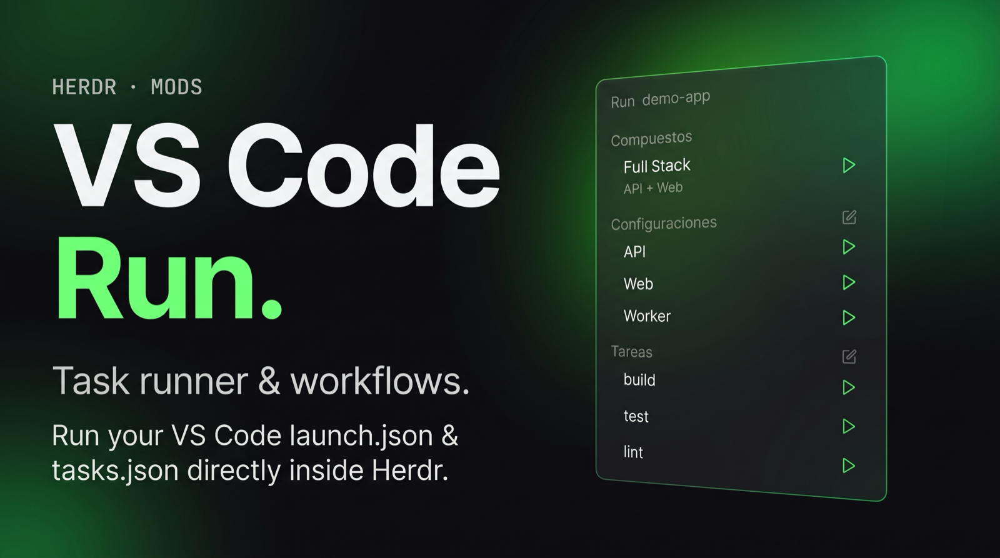

# VS Code Run

A sidebar panel that turns the `.vscode/launch.json` and `.vscode/tasks.json` of the folder you're working in into play buttons. Each compound, configuration or task opens in its own Herdr tab and runs as a plain command (no debugger); while that tab is open, its row shows restart and stop buttons. The UI text is in Spanish.



## What you see

Top to bottom, filling its block, on the theme's `chrome` background with a 1px `border` line on top; base text 13px:

- **Header** (41px tall, 16px side padding, 14px top): "Run" in 11.5px medium `dim`, then the base name of the folder that holds `.vscode` (11px `dim`, truncated).
- **A scrolling list** (8px side padding), in up to three groups, each with a 26px section title in 11px medium `dim`:
  - **Compuestos**: `launch.json` compounds; under the name, a 11px `dim` line with their configurations joined by " + ".
  - **Configuraciones**: `launch.json` configurations. The title has an edit button.
  - **Tareas**: `tasks.json` tasks (except `hide: true`); under the name, the task's `detail`. The title has an edit button.
- **Each row** (8px × 4px padding, 6px gap, 6px radius): a 6×6 dot (`working` color while its tab is open, transparent otherwise), the name in `foreground` (`dim` if it can't run), then the buttons on the right as 12px icons with 3px padding and 4px radius:
  - not running: ▶ play in `#89d185`;
  - running: ↻ restart in `#89d185` and ■ stop in `#f48771` (VS Code's debug toolbar colors).
- Group empty: left out. Parse errors: shown in 12px `blocked` text above the groups.
- No `.vscode` found: "No hay .vscode/launch.json ni tasks.json en esta carpeta ni en las de arriba." Files with nothing runnable: "launch.json y tasks.json no tienen nada que ejecutar."

## How it behaves

- **Which folder:** the focused pane's live folder (`panes()[i].cwd`), else `focused().cwd`, else the active space's folder; then the nearest folder going up that has `.vscode/launch.json` or `tasks.json`. It looks again as soon as the focused folder changes, and rereads both files every 2.5 s, so edits show without reloading.
- **Files:** JSON with comments (`//`, `/* */`) and trailing commas.
- **Play** (or clicking a row that isn't running): `tab.new` named after the item, in its `cwd`, running a shell (`sh -c`; `pwsh -EncodedCommand` on Windows) that prints `▶ name`, runs each step in order, stops at the first failure and stays open as an interactive shell. A compound opens one tab and splits it (`terminal.open` place right, then down) with one terminal per configuration.
- **Clicking a running row** selects its space and tab. The row has the `selected` background when its tab is the one shown.
- **Restart:** closes the tab and starts it again. **Stop:** `tab.close` with `confirmed: true`. Closing the tab by hand also returns the row to ▶.
- **Edit button:** `code -g <file>`; if VS Code isn't installed, a toast shows the path.
- **Unsupported items** are shown in `dim` with the reason as tooltip; clicking does nothing. Hover on a compound or task shows its sub-line as tooltip.
- **serverReadyAction** (`openExternally`): reads the terminal every 2 s for up to 5 min (`hc read`), matches `pattern` (default `listening on.* (https?://\S+|[0-9]+)`), and opens the address (a bare port becomes `http://localhost:<port>`) with `open` / `xdg-open` / `rundll32`, through `uriFormat`.
- **Keys / `herdr-app do launch.<cmd>`:** `c1`, `k2`, `t3` start compound/configuration/task N (1-based); `stop-t3`, `restart-c1`.
- Agent statuses don't apply; the dot shows only whether the item's tab is open.

What runs:

- Configurations: `node` / `pwa-node` (`runtimeExecutable` or `node`, `runtimeArgs`, `program`, `args`), `node-terminal` (`command`), `python` / `debugpy` (`python3`, `python` on Windows; `module` or `program`, `args`), `coreclr` / `dotnet` (`dotnet <program> <args>`; with no `preLaunchTask`, `dotnet build` of the folder above `bin/` first). `cwd` and `env` apply.
- Tasks: `shell` (a command line, or command + args), `process`, `npm` (`npm run <script>`, `path`), with `dependsOn` first, `options.cwd` / `options.env`, and `windows` / `osx` / `linux` overrides. `preLaunchTask` runs before its configuration.
- Variables: `${workspaceFolder}`, `${workspaceRoot}`, `${workspaceFolderBasename}`, `${userHome}`, `${pathSeparator}`, `${/}`, and `${env:NAME}` (left to the shell).

## Built from

- One mod, `mods/launch/`: `main.js`, `mod.json` (`{ "place": "none", "title": "VS Code Run" }`), and four 24×24 stroke icons tinted with the text color: `play.svg`, `rotate.svg`, `square.svg`, `edit.svg` (Lucide).
- Placed as a block in the layout, e.g. under `agents` in a clone of `main`'s `sidebar-lists` column: `{ "id": "launch", "type": "block", "size": { "weight": 1 }, "min": 90, "content": { "mod": "launch" } }`. No props.
- `herdr`: `spaces`, `panes`, `terminals`, `focused`, `theme`, `window`, `home`, `readTextFile`, `run`, `exec`, `hc`, `notify`, `nextCommand`; commands `tab.new`, `terminal.open`, `tab.close`, `space.select`, `tab.select`.
- Programs: `sh` / `pwsh`, whatever the configurations run, `code`, `open` / `xdg-open` / `rundll32`, `hc read`.
- State: `localStorage` `"tabs"` maps `"<workspace>|<kind>|<name>"` to the tab id it opened.

## Watch out

- `tab.new` doesn't return its tab to a mod: find the new tab by name among tabs that weren't there before, polling every 500 ms for up to 20 s. Each terminal of a compound is matched by its exact argv (last element), else by pane order.
- Quote every word for the shell (`'…'` with `'\''` on sh, `''` on PowerShell); pass PowerShell scripts base64 UTF-16LE through `-EncodedCommand` to avoid quoting entirely.
- Items using `${input:…}`, `${command:…}`, `${file…}`, `${selectedText}`, `${lineNumber}` or `${relativeFile}` can't run (only VS Code can answer them) and are shown as unsupported. So are other configuration types and task types.
- It runs the projects' own commands as written: only use it in repos you trust.
- Local machine only: it reads files with `readTextFile` without `on`, so spaces on other machines show nothing.
- `focused()` right after `run()` still names the old tab; don't use it to find the new one.
- Paths starting with `mods/launch/` are hard-coded (`ICON`); rename them if you rename the folder.

## Done when

- `herdr-app check ~/.config/herdr-app/mods/launch` passes.
- In a folder with the sample below, the panel lists Full stack (API + Web), API, Web, Worker, build, test and lint.
- ▶ on `build` opens a tab named "build" that prints `▶ build`, then `build`, and stays at a shell prompt; the row shows a dot plus ↻ and ■.
- ■ closes that tab and the row is back to ▶; ↻ replaces it with a fresh one.
- ▶ on Full stack opens one tab split in two terminals.
- Editing `tasks.json` (adding a task) shows the new row within 3 s; moving focus to a folder without `.vscode` shows the empty message.

```json
// .vscode/launch.json
{ "configurations": [
    { "name": "API", "type": "node", "request": "launch", "program": "${workspaceFolder}/server.js" },
    { "name": "Web", "type": "node-terminal", "request": "launch", "command": "echo web" },
    { "name": "Worker", "type": "python", "request": "launch", "module": "http.server" } ],
  "compounds": [ { "name": "Full stack", "configurations": ["API", "Web"] } ] }
// .vscode/tasks.json
{ "tasks": [
    { "label": "build", "type": "shell", "command": "echo build", "detail": "Compila el proyecto" },
    { "label": "test", "type": "shell", "command": "echo test", "detail": "Corre las pruebas" },
    { "label": "lint", "type": "shell", "command": "echo lint" } ] }
```
